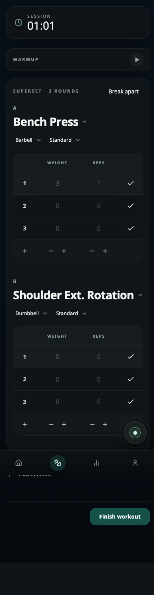
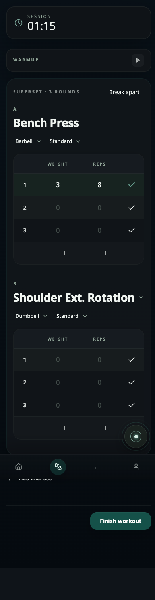
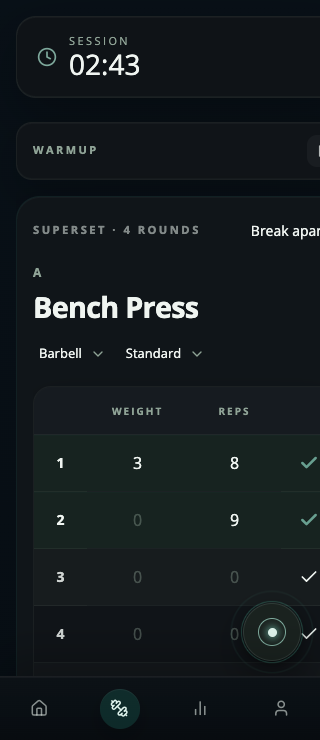
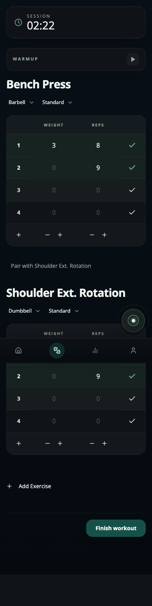

# I-49 — Superset design audit

2026-10-13. Audit only; no product changes. Existing fixed A/B pairing and shared round semantics preserved.

## Context

Workout logging for one user, between physically demanding sets. Clarity, reachable controls and fast recognition matter more than extra decoration.

Evidence: current local app, e2e account, Chromium at 390×844, 320×740 and 1440×1000. These are responsive web captures, **not native iPhone evidence**. No booted simulator was available. No workout was finalized or saved. Browser-local draft remains disposable.

## Supporting visuals

## First impressions

The stone group and quiet A/B labels establish a pair without competing accents. Completed rows use the expected pthalo wash. But the screen reads A1/A2/A3 then B1/B2/B3, while the task alternates members; the interface leaves that mental work to the user.

## Severity-ranked findings

| Priority | Observed finding | Evidence | Concrete fix |
| --- | --- | --- | --- |
| High | A browser-local long-name fixture also expands/clips the group at 390px ([15](15-long-name.png)). At 320px, Break apart ends at x339 and completion buttons at x325; viewport ends x320. Document scrollWidth remains 320. Warmup and Finish also extend outside viewport. | [09](09-small.png), [12](12-small-viewport.png); DOM bounds | Fix shared workout layout shrink/min-width constraints. Keep names and actions reachable at 320/390px and desktop. Investigate shared layout before blaming the group. |
| High | After A1, nothing identifies B1 as next. Every open row looks equally current; all A rows precede B. | [02](02-paired.png), [03](03-a1.png), [05](05-b2-first.png) | Show compact next member/exercise/round from the existing Set Plan cursor. Keep out-of-order logging available. |
| Medium | Completion and Add Round buttons measure 32×32 CSS px; pairing/breakup are 36px high. Completion names all say “Mark set as completed”, including completed rows; input names omit exercise/round. | [03](03-a1.png), [07](07-added-round.png); DOM/accessibility snapshots | Provide comfortable 44px touch areas; names include member/exercise, round and state. Verify keyboard and VoiceOver separately. |
| Medium | Two bare + controls look exactly like independent Add Set. Both actually add a round to both exercises; only the accessible label explains this. | [02](02-paired.png), [07](07-added-round.png) | One visible group “Add Round” action, preserving both sets and shared count. |
| Low | Rest entering the group header wraps “Superset · 3 rounds” from one line to two at 390px. | Compare [03](03-a1.png) and [04](04-round1.png) | Reserve a stable timer slot or give it a separate compact line; avoid moving the member below it. |

The four highest-impact fixes are drafted in [follow-ups.md](follow-ups.md). Linear creation is pending Executor confirmation; **no follow-up issues created yet**.

## Visual design

Pthalo completion fill, stone surfaces, restrained borders and tabular numbers match the design language. The shared group is a useful boundary; no extra metadata cards are needed. A/B labels are quiet but legible in these captures. The rest-header reflow is the main observed alignment issue. Initial 0:00 captures occur during the entrance animation; they do not establish a contrast defect.

## Interface design

We are missing an opportunity to direct the next action: after A1, point to B1 rather than asking the user to remember the alternation and scroll past A2/A3. A visible group Add Round would communicate scope with fewer duplicated actions. Pair with names the adjacent second exercise; the resulting top member is A and lower member B. Break apart is directly visible and preserves logged numbers.

## Consistency and conventions

Completed rows follow the app's tinted-fill/check convention. Reusing the independent + appearance hides the different scope of paired addition. Repeated accessible completion names omit both identity and checked state. Touch targets are small for logging under fatigue; actual native touch/VoiceOver behavior remains untested.

## User context

The user is likely focused on the next movement, with reduced attention after a set. A next-set cue and larger targets would reduce searching and precision demands. More explanatory prose would add burden; concise state and action labels suffice.

## Flow evidence

1. **Discover pairing — clear, small target.** Adjacent eligible Bench Press / Shoulder Ext. Rotation; Pair with names B. [01](01-unpaired.png).
2. **Create pair — functional, progression unclear.** A/B labels, three shared rounds, two + controls. [02](02-paired.png).
3. **Log A1 — functional, next cue absent.** 3kg × 8; tinted completion; no rest. [03](03-a1.png).
4. **Log B1 — functional.** 0kg × 8; rest appears only after both first-round sets. [04](04-round1.png).
5. **Log B2 before A2 — functional.** B2 records 9 reps; rest disappears while round incomplete. [05](05-b2-first.png).
6. **Log A2 — functional.** A2 records 9 reps; rest returns after completing the out-of-order round. [06](06-round2.png).
7. **Add Round — functional, scope visually ambiguous.** Both members gain fourth row; shared count becomes four; logs retained. [07](07-added-round.png).
8. **Reload partial pair — functional.** Pair, four rounds, and first two completed rows survive. Rest disappears after reload (local timer state); restoration expectations need a separate decision. [08](08-resumed.png).
9. **Small screen — clipped.** 320px cuts action edges; DOM bounds confirm overflow. [09](09-small.png), viewport [12](12-small-viewport.png).
10. **Web layout — readable, tall.** 1440px keeps member tables aligned; still no alternating next cue. [10](10-web.png).
11. **Break apart — functional.** Group/A/B labels disappear; four rows and logged values remain on both independent exercises; Pair with returns. [11](11-broken-apart.png).

12. **In-order second round — functional.** Reset A2/B2, then completed A2 and B2; round-only rest retained. [13](13-a2-in-order.png), [14](14-b2-in-order.png).
13. **Long name — clipped.** Synthetic browser-local fixture expands group at 390px. [15](15-long-name.png).

Full-page captures include fixed navigation/Coach overlays at the capture scroll position; their position inside a tall image is a screenshot artifact, not evidence that navigation divides the document. Use 12 for true viewport clipping evidence. All saved captures were opened and inspected; the first breakup capture caught an animation and was replaced with the settled state.

## Limits and hypotheses

- Native iPhone, Live Activity/lock screen, native resume and haptics: **untested**. No device screenshot available. Do not infer clarity from web screenshots or unit tests.
- VoiceOver, hardware touch, keyboard traversal, reduced motion and full contrast coverage: **untested**. Group-label contrast sampled from computed CSS: A/B approximately 6.85:1; kicker approximately 5.22:1 after compositing text alpha against nominal panel RGB. Panel alpha/gradient makes these estimates, not a complete contrast certification. DOM names/bounds support the listed risks, not full accessibility compliance.
- Long-name fixture: “Single-Arm Half-Kneeling Cable External Shoulder Rotation”, seeded only into this isolated browser’s persisted draft, never into the remote catalog. At 390px it expands the group and clips controls/name; observed, not hypothetical. Larger dynamic text remains untested.
- In-order A1→B1 and reverse second-round B2→A2 tested. Then toggled A2/B2 open and re-logged A2→B2: no rest after A2, rest after B2 ([13](13-a2-in-order.png), [14](14-b2-in-order.png)).
- Unit tests check deterministic semantics; they do not replace the missing native audit.

## Validation

Targeted Set Plan/workout reducer tests: 32 passed. Typecheck guard: 74 existing errors, baseline accepted. Full suite: 44 files, 398 tests passed; none skipped. No product code changed; TDD not applicable to this evidence-only deliverable.

## Code review

Standards: 0 findings. Spec: initial gaps in in-order second-round, long-name and contrast checks addressed above; supporting visuals moved before critique. Linear follow-ups remain pending required confirmation. Native evidence remains unavailable and disclosed.
